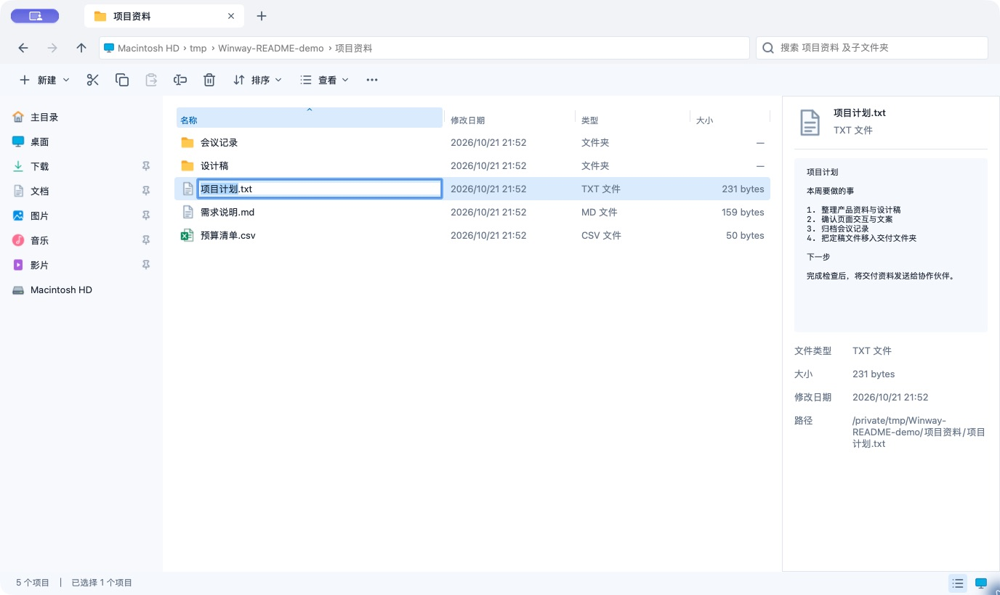
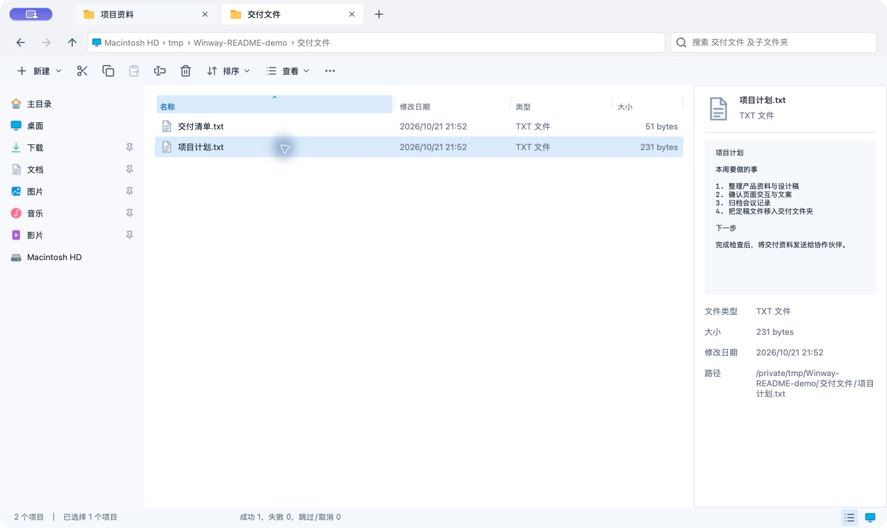
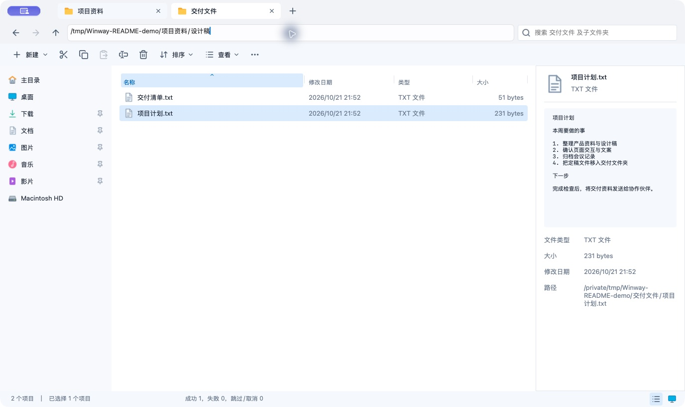

# Winway

**把 Windows 文件管理的肌肉记忆带到 Mac。**

Winway 是一款面向 Windows 迁移用户的原生 macOS 文件管理器，采用熟悉的 Windows 11 资源管理器布局，让打开、改名、复制、移动文件这些每天重复的操作，继续按习惯完成。

换了 Mac，常见的不适往往发生在小动作上：按 Enter 想打开文件，却进入了改名；想剪切再粘贴，需要重新记一组移动快捷键；拿到目录路径，习惯先点地址栏。Winway 的目的，就是减少这些反复打断操作的时刻。

[下载试用](#下载试用) · [操作截图](#日常操作) · [快捷键说明](docs/keyboard.md) · [反馈问题](https://github.com/Capyhw/winway/issues)

## 为什么用 Winway

- **常用按键保持熟悉**：默认 Enter 打开、F2 改名、Ctrl+C / X / V 复制、剪切和粘贴，支持鼠标前进、后退侧键。
- **整理文件少切换窗口**：多标签并排打开目录，跨标签移动文件；每个标签保留自己的浏览历史、排序、选择和滚动位置。
- **找文件、看内容更直接**：地址栏输入路径，按名称搜索当前目录及子文件夹，侧栏查看图片、文本预览和文件信息。
- **习惯可以自己决定**：Windows、macOS 两套快捷键预设，可逐项修改，分别保存。
- **与 Mac 的文件系统配合**：使用默认应用打开文件，也可通过右键「打开方式」选择其他应用；支持系统文件服务，删除进入系统废纸篓，遇到重名可跳过或保留两者。

这些快捷键在 Winway 内生效，不会修改其他应用的按键行为。

## 日常操作

以下均为 Winway 实际运行截图，使用专门准备的示例文件。

### 1. Enter 打开，F2 重命名

在 Finder 中，Return 用于重命名，打开文件通常使用 ⌘O 或 ⌘↓。如果你习惯了 Windows 的按法，这两个高频动作最容易按错。Winway 默认用 Enter 打开文件或进入文件夹，用 F2 开始行内重命名。

下图是选中「项目计划.txt」后按 F2 的状态：直接编辑文件名，无需打开额外对话框。

### 2. Ctrl+X → Ctrl+V，跨标签移动文件

在 Finder 中，移动已复制的文件使用 ⌘C → ⌥⌘V。Winway 保留剪切、粘贴的操作顺序：在来源标签按 Ctrl+X，切到目标目录后按 Ctrl+V。

下图中，「项目计划.txt」已从「项目资料」移入「交付文件」，底部显示操作成功。可以同时保留两个目录标签，继续整理下一批文件。标签右键菜单支持关闭当前、其余、左侧或右侧标签。

### 3. Ctrl+L，直接输入目录路径

拿到一个目录路径时，按 Ctrl+L 即可在地址栏编辑，输入或粘贴路径后按 Enter 跳转。支持绝对路径和 `~/` 路径；也可以使用面包屑逐级浏览。

下图展示在地址栏输入「项目资料/设计稿」目录的状态。查找文件时，Ctrl+F 可搜索当前目录及所有子文件夹，结果会显示文件所在位置。

### 4. 保留熟悉的按键，也能逐步适应 Mac

默认使用 Windows 预设，也可以切换到 macOS 预设，或只修改某一个操作的按键。两套配置独立保存，菜单提示会同步更新。

部分键盘的 F2 需要同时按 Fn，具体取决于系统设置。上面的 Finder 按键对照可参见 [Apple 快捷键说明](https://support.apple.com/en-us/102650)与[文件重命名说明](https://support.apple.com/guide/mac-help/rename-files-folders-and-disks-on-mac-mchlp1144/mac)。

## 常用快捷键

以下为默认 Windows 预设，`Ctrl` 指 Mac 键盘上的 **Control** 键。

| 操作 | 快捷键 |
| --- | --- |
| 打开文件 / 进入文件夹 | Enter |
| 重命名 | F2 |
| 复制 / 剪切 / 粘贴 | Ctrl+C / Ctrl+X / Ctrl+V |
| 全选 | Ctrl+A |
| 新建文件夹 | Ctrl+Shift+N |
| 新建 / 关闭标签 | Ctrl+T / Ctrl+W |
| 输入路径 / 搜索 | Ctrl+L / Ctrl+F |
| 后退 / 前进 / 上级目录 | Option+← / Option+→ / Option+↑ |
| 刷新 | F5 |
| 移到废纸篓 | ⌫（Backspace） |

完整预设及自定义规则见[快捷键说明](docs/keyboard.md)。

## 下载试用

目前处于早期开发阶段，尚未发布正式版本。可以在 [Release macOS 构建页面](https://github.com/Capyhw/winway/actions/workflows/release.yml)选择一次成功的运行，在 **Artifacts** 下载测试包（下载 Actions 产物需要登录 GitHub）。正式版本将通过 [Releases](https://github.com/Capyhw/winway/releases)提供。

- Apple Silicon（M 系列芯片）：选择 `arm64`。
- Intel Mac：选择 `x86_64`。
- 解开下载的产物后，使用其中的 DMG 或 ZIP，将 `Winway.app` 放入「应用程序」。

目标系统为 macOS 13 及以上；不同系统版本的兼容性仍在完善。目前安装包使用 ad-hoc 签名，尚未经过 Apple Developer ID 签名与公证，首次打开可能遇到系统安全提示。

## 当前边界

- 复制、剪切在 Winway 内共享，支持跨标签；尚未与 Finder 的文件剪贴板互通。
- 内置预览支持 PNG、JPEG 和 UTF-8 文本；PDF、Office 等格式可用系统默认应用打开。
- 「打开方式」多选时只列出能打开全部所选文件的应用；「服务」由 macOS 按当前选择及已启用服务提供。Finder 专属扩展菜单不在支持范围内，第三方应用的目录授权仍由该应用处理。
- 同名文件支持跳过、保留两者或取消，不提供覆盖和目录合并。
- 删除进入系统废纸篓，不提供永久删除。批量操作会报告成功和失败项，已完成的操作不会自动回滚。

## 开发与反馈

欢迎通过 [Issues](https://github.com/Capyhw/winway/issues)反馈迁移到 Mac 后最不适应的文件操作，或提交复现步骤与截图。

- [本地构建与测试](docs/development.md)
- [Release 自动打包](docs/releasing.md)
- [文件操作行为](docs/file-service.md)
- [验收记录与已知边界](docs/acceptance.md)
