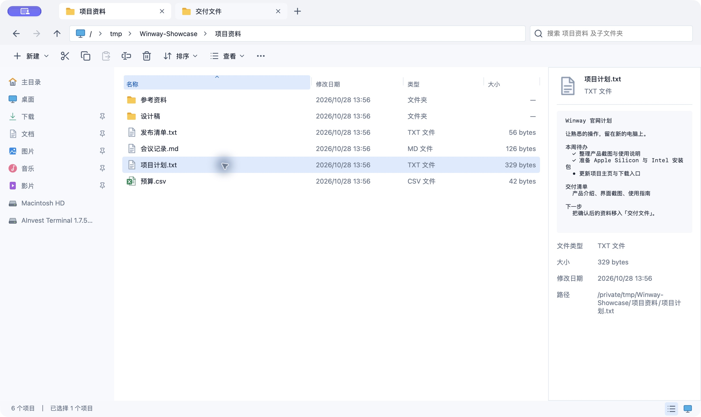
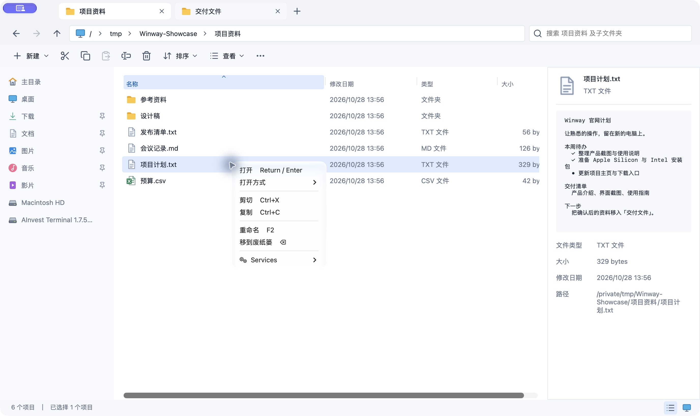

# Winway

**换了 Mac，习惯不用换。**

Winway 是一款面向 Windows 迁移用户的原生 macOS 文件管理器。熟悉的资源管理器布局、Enter 打开、F2 改名、Ctrl+X / V 移动文件，再加上多标签拖拽、索引搜索和 Mac 的原生文件服务，让每天的文件操作继续顺手。

[项目官网](https://capyhw.github.io/winway/) · [下载最新版](https://github.com/Capyhw/winway/releases/latest) · [使用须知](#使用须知) · [反馈问题](https://github.com/Capyhw/winway/issues)



## 下载与安装

在 [GitHub Releases](https://github.com/Capyhw/winway/releases/latest) 下载最新版本，无需登录即可下载安装包。最低编译目标为 **macOS 13**，提供两种架构：

| 你的 Mac | 选择安装包 |
| --- | --- |
| Apple Silicon（M 系列芯片） | `Winway-<版本>-macos-arm64.dmg` |
| Intel 处理器 | `Winway-<版本>-macos-x86_64.dmg` |

在 ** → 关于本机** 查看芯片。打开 DMG，将 Winway 拖入「应用程序」；也可以下载 ZIP，解压后移动 `Winway.app`。每个架构同时提供 `.sha256` 校验文件。

当前安装包使用 ad-hoc 签名，**尚未经过 Apple Developer ID 签名与公证**，首次打开可能出现系统安全提示。请先确认下载来自本项目 Releases，再按 macOS「系统设置 → 隐私与安全性」提示处理。不同 macOS 版本的兼容性仍需更多实机反馈。

## 用得顺手的操作

### 熟悉的按键，也能自己调整

默认使用 Windows 预设：Enter 打开文件或进入文件夹，F2 行内改名，Ctrl+C / X / V 复制、剪切、粘贴。支持键盘选择、鼠标框选、多选和鼠标前进／后退侧键。

在设置中切换 Windows / macOS 预设，或单独修改、清除、恢复某个快捷键。两套自定义配置独立保存；录入时检查冲突，菜单提示同步更新。快捷键仅在 Winway 内生效，不改变其他应用。


### 多标签与拖拽，少切换几个窗口

- 并排打开多个目录，拖动标签调整顺序；每个标签独立保留浏览历史、排序、选择和滚动位置。
- 右键标签可关闭当前、其余、左侧或右侧标签。
- 拖动一个或多个文件／文件夹，放入文件列表中的文件夹或当前目录空白处即可移动。
- 拖着文件悬停到另一标签约 0.6 秒，自动切换到该目录，再继续拖放。目标位置会高亮；不能移动到原位置、文件夹自身或其子目录。
- 也可按 Ctrl+X，切换标签，再按 Ctrl+V；批量操作在状态栏报告结果。


### FSearch 索引搜索，包含子文件夹

按 Ctrl+F，在当前目录及所有子文件夹中搜索。Winway 内置 FSearch 辅助程序，使用索引查询，结果显示文件所在位置；无需另外安装搜索工具。

| 查询示例 | 用途 |
| --- | --- |
| `mian.swift` | 模糊名称匹配，允许一定程度的拼写错误 |
| `ext:pdf report` | 按扩展名筛选并匹配名称 |
| `type:image` | 查找图片 |
| `grep:invoice` | 查找包含指定文本的文件 |

首次搜索需要建立索引，文件变化同步可能存在延迟。桌面、文档、下载等受保护目录需要相应权限；内容索引也有类型和大小限制。查看 [搜索语法、覆盖范围与权限配置](docs/search.md)。


### 路径导航与预览，少打断手上的事

面包屑逐级跳转，Ctrl+L 切换路径编辑，支持绝对路径和 `~/` 路径。后退、前进和上级目录都有快捷键，也支持鼠标侧键导航。

选择文件后，右侧直接预览 PNG、JPEG 和 UTF-8 文本，同时显示类型、大小、修改时间和完整路径。多选时可查看文件总大小；零字节文件明确显示为 `0 bytes`。隐藏文件显示、排序和详情面板均可切换。

### 与 Mac 的应用和文件系统配合

右键菜单按用途分组，显示当前快捷键；可以使用默认应用打开文件，也可以通过「打开方式」选择其他应用。多选时，只列出能打开全部所选文件的应用。系统文件服务按当前选择和 macOS 中已启用的服务提供。

同名文件可以跳过、保留两者或取消，删除进入系统废纸篓。复制和移动逐项报告结果，跨卷移动在复制成功后再删除源文件。



以上截图均于 **2026-10-28** 使用当前源码构建的应用拍摄，内容为专门准备的示例文件。截图来源及版本记录见 [截图说明](docs/screenshots/2026-10-28/README.md)。

## 常用快捷键

以下为默认 **Windows 预设**。`Ctrl` 指 Mac 键盘上的 **Control**，不是 Command；部分键盘需使用 Fn+F2。

| 操作 | 快捷键 |
| --- | --- |
| 打开文件／进入文件夹 | Enter |
| 行内重命名 | F2 |
| 复制／剪切／粘贴 | Ctrl+C / Ctrl+X / Ctrl+V |
| 全选 | Ctrl+A |
| 新建文件夹 | Ctrl+Shift+N |
| 新建／关闭标签 | Ctrl+T / Ctrl+W |
| 编辑路径／搜索 | Ctrl+L / Ctrl+F |
| 后退／前进／上级目录 | Option+← / Option+→ / Option+↑ |
| 刷新 | F5 |
| 移到废纸篓 | ⌫（Backspace） |
| 显示隐藏文件 | Ctrl+Shift+. |
| 显示详情 | Option+P |
| 打开设置 | Ctrl+, |

macOS 预设、按键录入与冲突规则见 [快捷键说明](docs/keyboard.md)。

## 使用须知

- **文件剪贴板**：复制、剪切在 Winway 内共享，支持跨标签；尚未与 Finder 的文件剪贴板互通。
- **文件拖拽**：当前提供 Winway 内的文件移动，不能据此认为已支持与其他应用互拖或按修饰键切换复制。
- **搜索覆盖**：受系统权限、索引进度、文件大小和类型限制；外接卷覆盖不能保证。结果为空不代表磁盘上不存在该文件。
- **文件预览**：内置支持 PNG、JPEG 和 UTF-8 文本；PDF、Office 等格式可用其他应用打开。
- **同名冲突**：不提供覆盖和目录合并；可跳过、保留两者或取消。
- **删除与批量任务**：删除进入废纸篓，不提供永久删除；已完成的批量操作不会自动回滚。
- **系统集成**：Finder 专属扩展菜单不在支持范围内，第三方应用的目录访问权限仍由该应用处理。

## 开发、文档与反馈

Winway 使用 Swift、AppKit 与 SwiftUI，搜索集成 [FSearch](https://github.com/noahdunnagan/fsearch)。应用安装包已包含搜索辅助程序和其许可证。

```sh
# 核心测试
./scripts/test.sh

# 构建可运行的 macOS 应用
./scripts/build-app.sh release
open dist/Winway.app
```

构建环境、架构与依赖要求见 [本地构建与测试](docs/development.md)。

- [快捷键与自定义规则](docs/keyboard.md)
- [FSearch 搜索与权限](docs/search.md)
- [文件操作与数据保护边界](docs/file-service.md)
- [双架构 Release 自动打包](docs/releasing.md)
- [官网与 GitHub Pages 部署](docs/website.md)
- [历史验收记录](docs/acceptance.md)

欢迎在 [Issues](https://github.com/Capyhw/winway/issues) 反馈使用问题或最想保留的 Windows 操作习惯。报告问题时，请附上 macOS 版本、芯片类型、Winway 版本与复现步骤。
